# Aplikasi Data Karyawan

Aplikasi administrasi karyawan untuk mengelola data pegawai, absensi, dan pengajuan cuti dengan akses admin dan karyawan.


## Tentang Proyek

Aplikasi Data Karyawan membantu admin dan karyawan mengelola administrasi SDM, absensi, serta pengajuan cuti. Aplikasi dibangun dengan Laravel 10 dan antarmuka Argon Dashboard; akses fitur dibedakan menjadi role admin dan karyawan.

## Fitur Utama

- Dashboard ringkas untuk admin dan karyawan.
- Pengelolaan akun dengan role admin dan karyawan.
- Pengelolaan data karyawan, divisi, jabatan, dan jenis cuti.
- Pencatatan absensi harian karyawan.
- Pengajuan cuti serta alur persetujuan admin.
- Unggah foto pada data karyawan.

## Tampilan Aplikasi

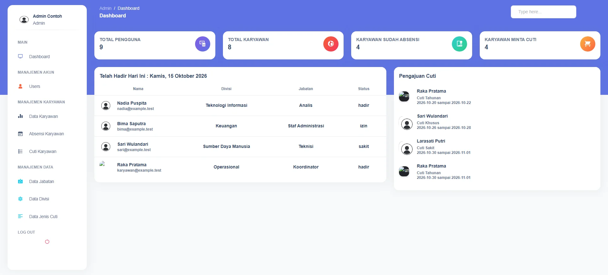
<p align="center"><em>Dashboard admin dengan ringkasan dan aktivitas karyawan.</em></p>

<table>
  <tr>
    <td align="center">
      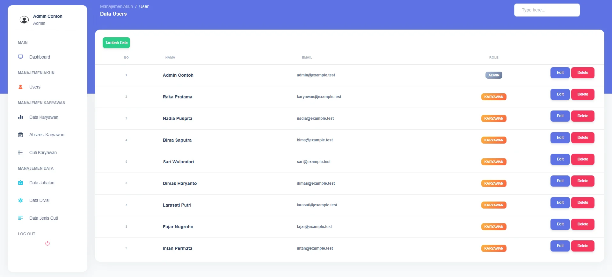<br>
      <em>Daftar akun pengguna beserta role akses.</em>
    </td>
    <td align="center">
      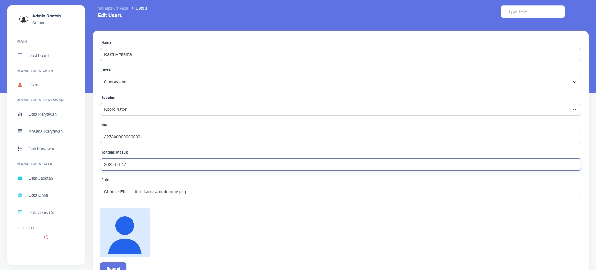<br>
      <em>Form edit karyawan terisi dengan foto dummy terpilih (bagian 1 dari 2).</em>
    </td>
  </tr>
  <tr>
    <td align="center">
      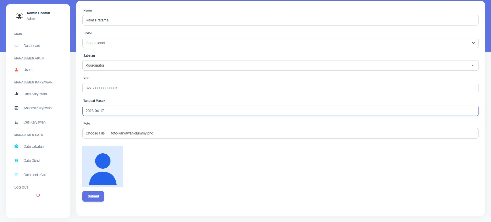<br>
      <em>Form edit karyawan terisi dengan foto dummy terpilih (bagian 2 dari 2).</em>
    </td>
    <td align="center">
      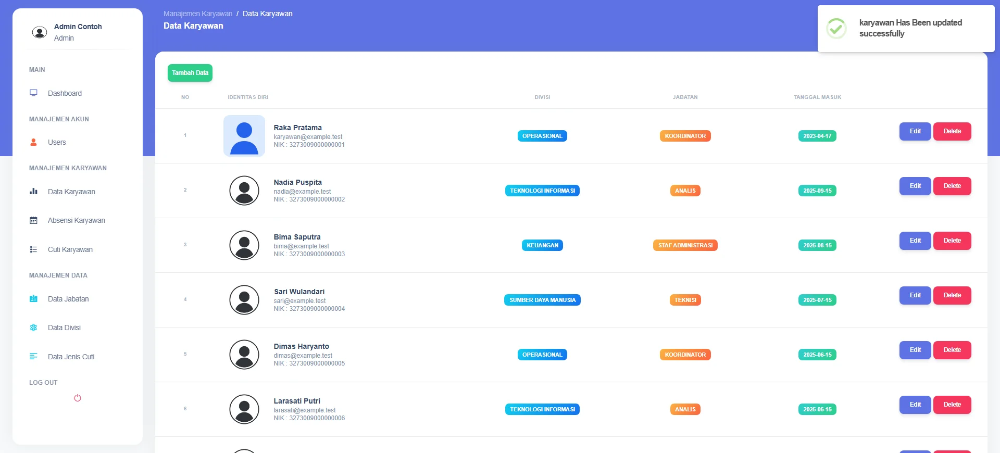<br>
      <em>Foto dummy berhasil disimpan pada data karyawan (bagian 1 dari 2).</em>
    </td>
  </tr>
  <tr>
    <td align="center">
      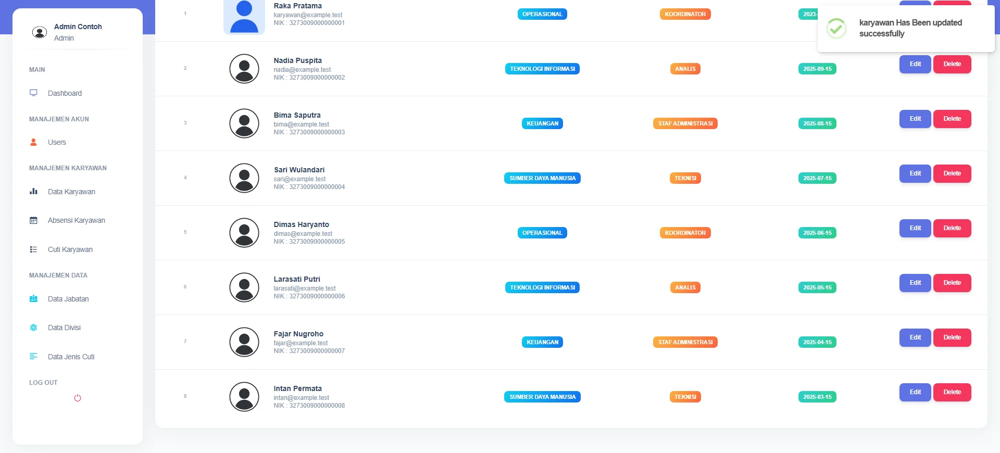<br>
      <em>Foto dummy berhasil disimpan pada data karyawan (bagian 2 dari 2).</em>
    </td>
    <td align="center">
      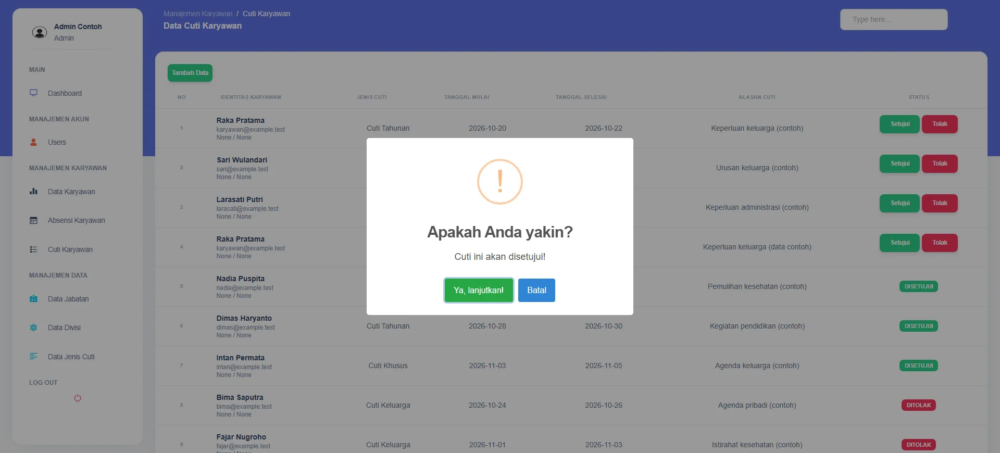<br>
      <em>Konfirmasi admin sebelum menyetujui pengajuan cuti (bagian 1 dari 2).</em>
    </td>
  </tr>
  <tr>
    <td align="center">
      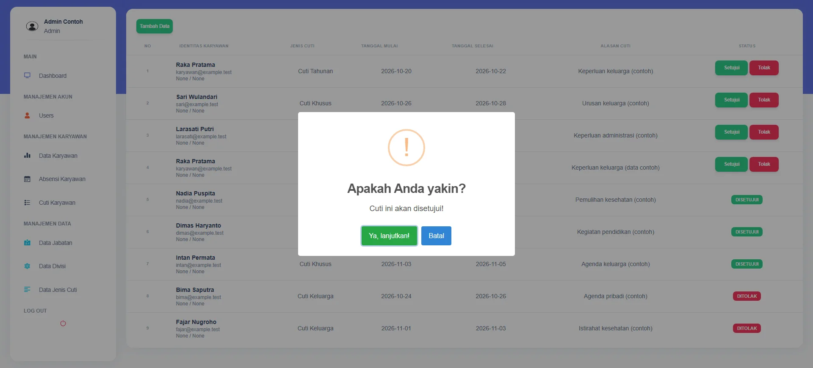<br>
      <em>Konfirmasi admin sebelum menyetujui pengajuan cuti (bagian 2 dari 2).</em>
    </td>
    <td align="center">
      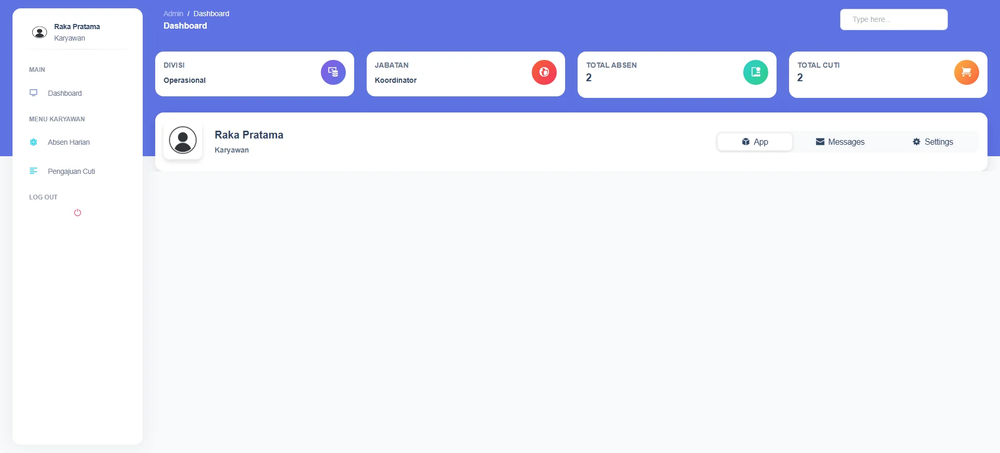<br>
      <em>Dashboard karyawan dengan ringkasan data pribadi.</em>
    </td>
  </tr>
  <tr>
    <td align="center">
      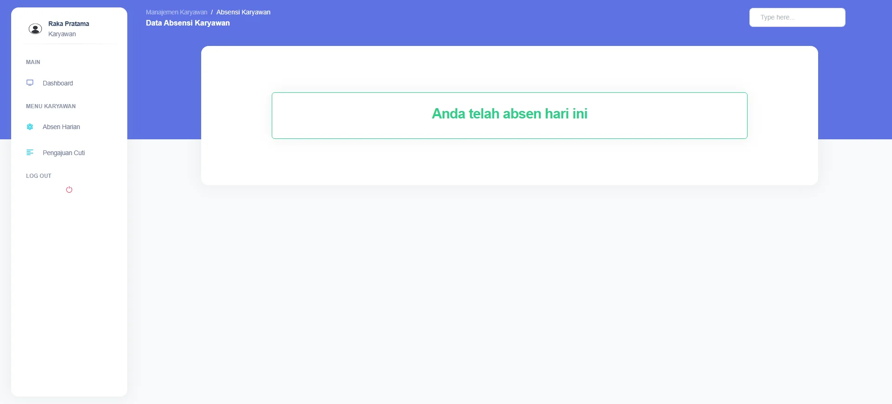<br>
      <em>Status absensi harian setelah karyawan mencatat kehadiran.</em>
    </td>
    <td align="center">
      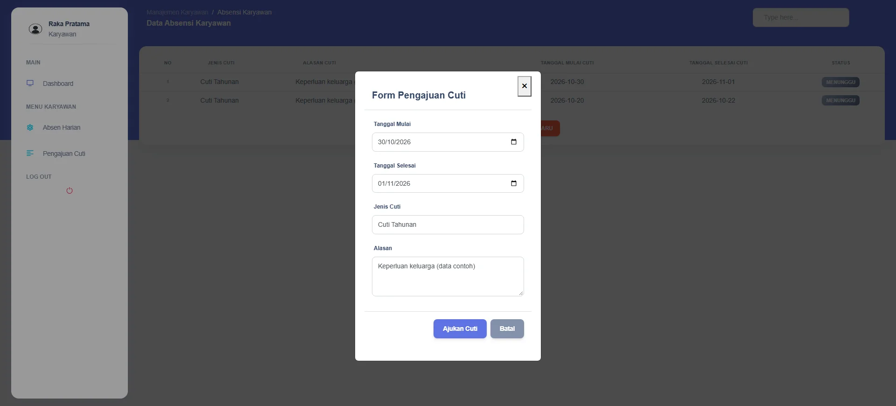<br>
      <em>Form pengajuan cuti karyawan terisi dengan data contoh.</em>
    </td>
  </tr>
  <tr>
    <td align="center">
      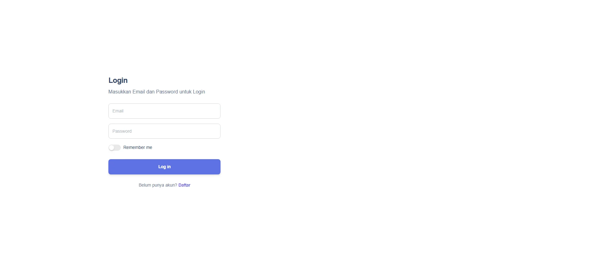<br>
      <em>Form login aplikasi untuk autentikasi pengguna.</em>
    </td>
    <td align="center"></td>
  </tr>
</table>

## Teknologi

| Kategori | Teknologi |
|---|---|
| Backend | Laravel 10, PHP 8.1+ |
| Antarmuka | Argon Dashboard 2.0.4, Bootstrap 5 |
| Grafik dan notifikasi | Chart.js, SweetAlert2 |
| Database | MySQL (konfigurasi default); SQLite tersedia pada konfigurasi Laravel dan digunakan untuk pengambilan screenshot |
| API | Laravel Sanctum |
| Build aset | Vite |

## Peran dan Hak Akses

| Peran | Kemampuan |
|---|---|
| Admin | Mengelola akun, data karyawan, divisi, jabatan, jenis cuti, absensi, dan persetujuan cuti. |
| Karyawan | Melihat dashboard pribadi, mencatat absensi harian, dan mengajukan cuti. |

## Instalasi dan Menjalankan Lokal

### Prasyarat

- PHP 8.1 atau lebih baru dan Composer.
- MySQL untuk konfigurasi database default; driver PDO yang sesuai dengan database pilihan.
- Node.js dan npm jika ingin membangun aset frontend.

### Langkah instalasi

Perintah berikut menggunakan PowerShell:

1. Clone repository setelah tersedia di GitHub:

   ```powershell
   $repoUrl = Read-Host "URL repository GitHub"
   git clone $repoUrl aldoni
   Set-Location aldoni
   ```

2. Pasang dependency PHP:

   ```powershell
   composer install
   ```

3. Buat konfigurasi lokal dan kunci aplikasi:

   ```powershell
   Copy-Item .env.example .env
   php artisan key:generate
   ```

4. Edit `.env` untuk mengatur koneksi database. Buat database terlebih dahulu, lalu isi `DB_CONNECTION`, `DB_HOST`, `DB_PORT`, `DB_DATABASE`, `DB_USERNAME`, dan `DB_PASSWORD` sesuai lingkungan lokal.

5. Buat tabel aplikasi:

   ```powershell
   php artisan migrate
   ```

   `DatabaseSeeder` saat ini tidak membuat data awal dan tidak memanggil seeder akun demo. Tinjau seeder opsional sebelum dijalankan; seeder admin terpisah berisi akun berkredensial hard-coded yang tidak didokumentasikan sebagai akun demo.

6. Pasang dependency frontend dan bangun aset:

   ```powershell
   npm install
   npm run build
   ```

7. Jalankan server pengembangan Laravel:

   ```powershell
   php artisan serve
   ```

Foto karyawan pada alur unggah saat ini disimpan di `public/images`; perintah `php artisan storage:link` tidak diperlukan untuk alur tersebut. Atur `APP_DEBUG=false` dan gunakan kredensial serta kunci aplikasi khusus untuk lingkungan produksi.

## Konfigurasi Penting

| Variabel | Fungsi |
|---|---|
| `APP_NAME` | Nama aplikasi. |
| `APP_ENV` | Lingkungan aplikasi, misalnya lokal atau produksi. |
| `APP_KEY` | Kunci enkripsi aplikasi; buat secara lokal dengan `php artisan key:generate`. |
| `APP_DEBUG` | Mengaktifkan atau menonaktifkan detail debug. Nonaktifkan di produksi. |
| `APP_URL` | URL dasar aplikasi. |
| `DB_CONNECTION` | Driver database yang digunakan. |
| `DB_HOST`, `DB_PORT` | Host dan port database. |
| `DB_DATABASE` | Nama database atau path SQLite. |
| `DB_USERNAME`, `DB_PASSWORD` | Kredensial database. |
| `SESSION_DRIVER` | Penyimpanan sesi aplikasi. |
| `QUEUE_CONNECTION` | Driver antrean pekerjaan. |
| `MAIL_MAILER` | Driver pengiriman email. |
| `FILESYSTEM_DISK` | Disk filesystem Laravel default. |

## Struktur Folder

```text
app/                  Controller, middleware, dan model
database/
  migrations/         Skema users, karyawan, absensi, cuti, dan data terkait
  seeders/            Seeder database
public/               Aset publik dan tujuan unggah foto karyawan
resources/views/      Halaman Blade
routes/               Route web dan API
screenshots/          Screenshot portofolio dan project-summary.json
scripts/              Helper pengambilan screenshot dan data demo SQLite
tests/                Contoh test Laravel/PHPUnit
```

## Pengujian

Jalankan test yang tersedia dengan:

```powershell
php artisan test
```

Test yang ada merupakan test contoh dasar Laravel dan PHPUnit.
